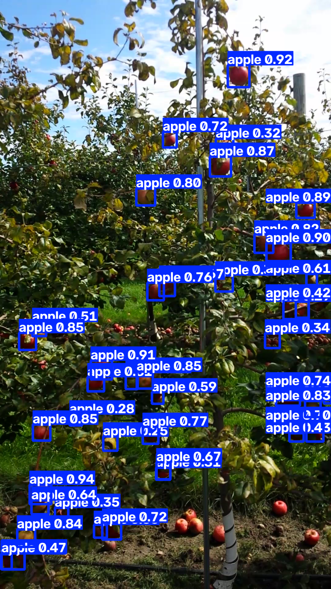
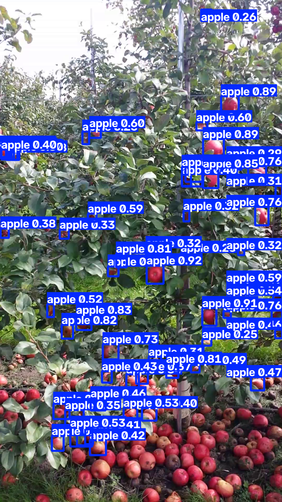
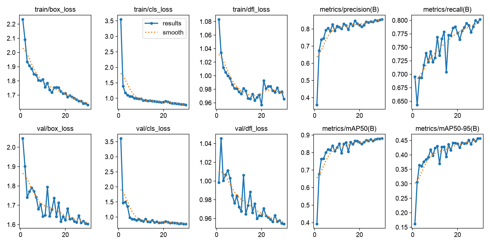
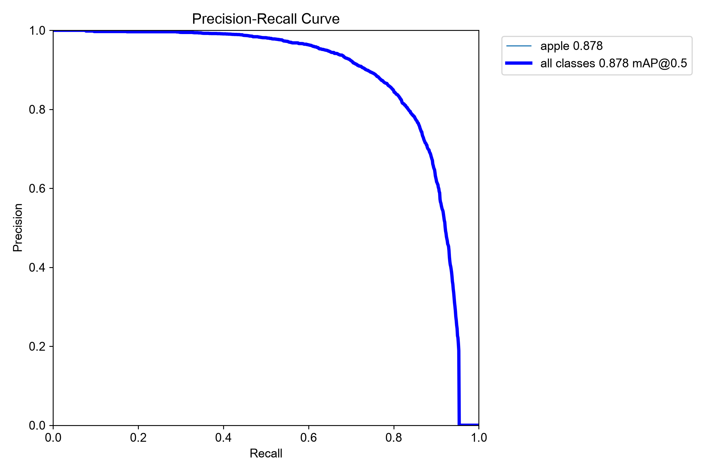
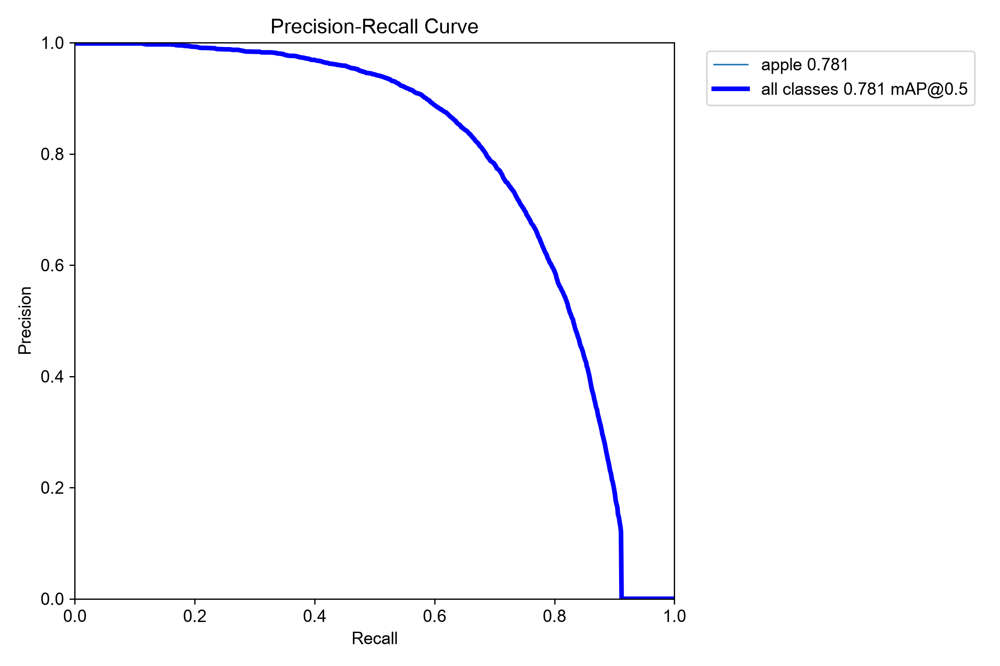
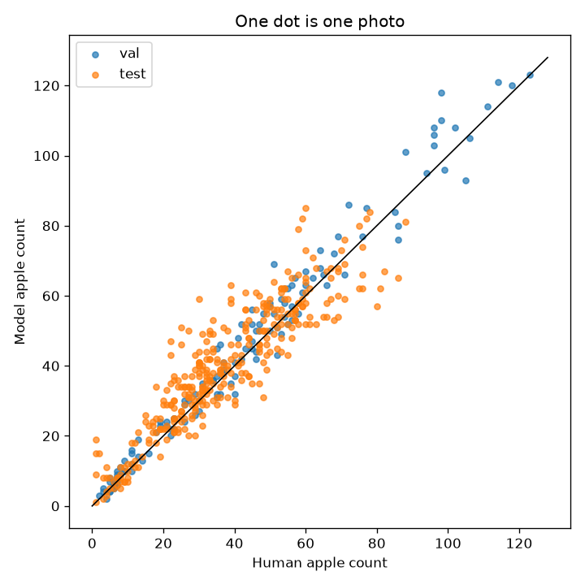

# Apple Counting with YOLO11n

This project detects and counts visible apples in orchard photographs. I fine-tuned YOLO11n on
MinneApple, converting the dataset's instance masks to bounding boxes for training. I chose
detection-based counting instead of direct count regression because each box gives the location
of an apple, and the retained detections can be counted directly.

At epoch 30, the model reached 88.0% mAP@50 on the 134-image validation split. The saved
checkpoint reached 78.10% mAP@50 on the independent 331-image test split, with a test counting
MAE of 6.36 apples per image.

## Qualitative results

These are predictions from the saved checkpoint at a confidence threshold of 0.25. The first
example has an exact image-level count. The second is the largest test-set error and illustrates
the model's tendency to overcount in some scenes.

| Exact count | Overcount failure case |
|:---:|:---:|
|  |  |
| Ground truth: **41** · Predicted: **41** | Ground truth: **30** · Predicted: **59** |

The images are MinneApple derivatives and retain the dataset's non-commercial license; see
[Third-party notices](THIRD_PARTY_NOTICES.md).

## Method

### 1. Annotation conversion

MinneApple training annotations are instance masks: background pixels are zero and each apple has
a distinct nonzero ID. For each instance, the preprocessing code computes the inclusive minimum
and maximum pixel coordinates and converts the enclosing rectangle to normalized YOLO format:

```text
class_id x_center y_center width height
```

There is one class, `apple` (`class_id = 0`). The original 670 annotated training images are
shuffled with split seed 42; 20% are held out for validation. The official 331-image detection
test set remains independent.

### 2. Detector

The model is YOLO11n initialized from the Ultralytics pretrained checkpoint. It is a one-stage,
anchor-free detector with a convolutional backbone, multi-scale feature fusion, and detection
heads at strides 8, 16, and 32. The fine-tuned one-class network has 2,590,035 parameters.

### 3. Counting

Inference uses 960-pixel inputs. Detections below confidence 0.25 are discarded. NMS uses an IoU
threshold of 0.7, and at most 300 detections are retained per image; these were the Ultralytics
8.4.163 defaults used by the original experiment and are now explicit CLI defaults. The
image-level estimate is simply:

```text
predicted apple count = number of retained detection boxes
```

This is detection-based counting, not direct count regression. A false positive adds one to the
count, while a false negative removes one; the two error types can also cancel at image level.

## Dataset

The experiment uses [MinneApple](https://doi.org/10.13020/8ecp-3r13), a benchmark for apple
detection, segmentation, and counting introduced by Häni, Roy, and Isler.

| Split | Images | Apple instances | Use |
|---|---:|---:|---|
| Train | 536 | 22,523 | Weight optimization |
| Validation | 134 | 5,660 | Training-time detection evaluation |
| Test | 331 | 12,285 | Independent detection and count evaluation |
| **Total** | **1,001** | **40,468** | |

Raw images, masks, and downloaded archives are excluded from this repository. MinneApple is
distributed separately under CC BY-NC-SA 3.0 US. Download it from the source and review its terms
before use. See [`data/README.md`](data/README.md) for the expected local layout.

## Training configuration

The training configuration comes from the saved run arguments and source code.

| Setting | Value |
|---|---|
| Architecture | YOLO11n detection |
| Initialization | Ultralytics `yolo11n.pt` |
| Classes | 1 (`apple`) |
| Epochs | 30 |
| Image size | 960 |
| Batch size | 8 |
| Optimizer | Ultralytics `auto` |
| Device used | Apple Silicon MPS |
| Workers | 2 |
| Early-stopping patience | 15 |
| Training seed | 0 (Ultralytics default, deterministic mode) |
| Train/validation split seed | 42 |

The machine-readable configuration is in [`configs/train.yaml`](configs/train.yaml). The recorded
run completed in approximately 20 minutes 41 seconds on the original machine.

## Results

### Detection on the validation split

These Ultralytics box metrics are from epoch 30 on the **134-image validation split**. The
independent test results are reported separately below.

| Metric | Value |
|---|---:|
| Precision | 85.6% |
| Recall | 80.2% |
| mAP@50 | 88.0% |
| mAP@50–95 | 45.7% |

`mAP@50` is the area under the precision-recall curve when a predicted box requires IoU ≥ 0.50
to match an annotation. `mAP@50–95` averages AP over IoU thresholds from 0.50 to 0.95 and is more
sensitive to precise box localization.



<p align="center">
  
</p>

### Detection on the independent test split

After training, I evaluated the saved checkpoint against the 331-image independent test split.
The checkpoint and thresholds were not tuned on test data. Evaluation used the Ultralytics
validation confidence threshold of 0.001—not the 0.25 counting threshold—with NMS IoU 0.7,
`max_det=300`, and AP matching thresholds from 0.50 to 0.95.

| Metric | Epoch-30 validation | Independent test |
|---|---:|---:|
| Precision | 85.6% | **80.32%** |
| Recall | 80.2% | **68.34%** |
| mAP@50 | 88.0% | **78.10%** |
| mAP@50–95 | 45.7% | **42.19%** |

The evaluation settings, full-precision metrics, and log are saved in
[`settings.json`](experiments/yolo11n_960/test_detection/settings.json),
[`metrics.json`](experiments/yolo11n_960/test_detection/metrics.json), and
[`evaluation.log`](experiments/yolo11n_960/test_detection/evaluation.log).



### Image-level counting

The saved best checkpoint was evaluated at confidence 0.25. Count metrics were recomputed from
the committed per-image predictions in
[`experiments/yolo11n_960/count_predictions.csv`](experiments/yolo11n_960/count_predictions.csv).

| Metric | Validation (134 images) | Independent test (331 images) |
|---|---:|---:|
| MAE (apples/image) | 3.94 | **6.36** |
| RMSE (apples/image) | 5.41 | **8.49** |
| Mean signed error | +2.19 | **+2.79** |
| Mean ground-truth count | 42.24 | 37.11 |
| Mean predicted count | 44.43 | 39.90 |
| Pearson correlation | 0.988 | **0.904** |

On the test set, the human-annotated total was 12,285 and the model predicted 13,207, an aggregate
overcount of 922 apples (7.5%). MAE measures typical absolute error; RMSE gives extra weight to
large errors; signed error exposes the systematic overcount. Correlation measures ranking
agreement and should not be interpreted as counting accuracy.



Artifacts for training-time validation detection, independent test detection, and image-level
counting are kept separately under [`experiments/yolo11n_960/`](experiments/yolo11n_960/).

### Error analysis

Of the 331 test images, the model overcounted 204, undercounted 110, and exactly matched 17. The
largest overcount was `dataset1_back_181.png` (30 ground-truth, 59 predicted; error +29). The
largest undercount was `dataset3_back_630.png` (80 ground-truth, 57 predicted; error −23). These
extremes help explain why test RMSE (8.49) is higher than MAE (6.36), while the 204/331 overcount
frequency is consistent with the positive mean signed error. The individual predictions are in
the committed per-image CSV.

## Installation

The recorded environment used Python 3.12.14. The package supports Python 3.10 or newer, but the
fully pinned environment was verified only on the recorded Python version and macOS setup.

```bash
git clone https://github.com/akshithcoder/apple-counting-yolo11.git
cd apple-counting-yolo11

python3.12 -m venv .venv
source .venv/bin/activate
python -m pip install --upgrade pip
python -m pip install -e ".[dev]"
```

PyTorch installation can be platform-specific. If the pinned wheel is unavailable for your
platform, install the appropriate PyTorch build first, then install the remaining dependencies.

## Reproducing the workflow

All commands below are run from the repository root.

### 1. Prepare MinneApple

Download and extract `detection.tar.gz` and `test_data.zip` according to
[`data/README.md`](data/README.md), then run:

```bash
python scripts/prepare_data.py \
  --minneapple-root data/minneapple \
  --output data/yolo
```

Use `--overwrite` only when intentionally replacing a previous generated split. The command
creates symbolic links rather than duplicating the multi-gigabyte image collection.

Expected output:

```text
train: 536 images, 22523 apples
validation: 134 images, 5660 apples
test: 331 images, 12285 apples
```

### 2. Train

The checked-in configuration targets Apple Silicon:

```bash
python scripts/train.py --config configs/train.yaml
```

Override the device on another platform:

```bash
python scripts/train.py --config configs/train.yaml --device cpu
# or --device 0 for the first CUDA GPU
```

Training is stochastic despite deterministic settings across some hardware and library versions;
minor numerical differences from the committed run are possible.

### 3. Evaluate image-level counts

```bash
python scripts/evaluate_counts.py \
  --weights weights/apple-yolo11n-best.pt \
  --data-root data/yolo \
  --confidence 0.25 \
  --nms-iou 0.7 \
  --max-detections 300 \
  --image-size 960
```

This writes per-image predictions, a JSON summary, and a count scatterplot under
`runs/count-evaluation/`.

### 4. Evaluate independent test-set detection

This uses the standard low-confidence validation setting needed to construct a precision-recall
curve, separately from the 0.25 confidence threshold used for counting.

```bash
python scripts/evaluate_detection.py \
  --weights weights/apple-yolo11n-best.pt \
  --data data/yolo/dataset.yaml \
  --output runs/test-detection/yolo11n-960 \
  --image-size 960 \
  --batch 8 \
  --device mps
```

### 5. Audit train/validation capture sessions

```bash
python scripts/audit_split.py \
  --data-root data/yolo \
  --output runs/split-audit.json
```

### 6. Run inference

```bash
python scripts/predict.py path/to/image-or-directory \
  --weights weights/apple-yolo11n-best.pt \
  --confidence 0.25 \
  --nms-iou 0.7 \
  --max-detections 300
```

Annotated images are saved to `runs/predict/`, and each predicted count is printed to the console.

### 7. Run the lightweight checks

```bash
ruff check src scripts tests
pytest
```

The unit tests cover instance-mask conversion, fractional bounding-box normalization, missing
labels, empty split directories, capture-session parsing, input validation, and count-metric
calculations. GitHub Actions runs the same checks without downloading MinneApple or loading the
neural-network checkpoint. The executed end-to-end verification record is in
[`VERIFICATION.md`](VERIFICATION.md).

## Repository layout

```text
.
├── .github/workflows/tests.yml
├── assets/
│   ├── figures/
│   └── predictions/
├── configs/train.yaml
├── data/README.md
├── experiments/yolo11n_960/
│   ├── count_predictions.csv
│   ├── metrics.json
│   ├── split_audit.json
│   ├── test_detection/
│   ├── train_args.yaml
│   └── training_metrics.csv
├── scripts/
│   ├── audit_split.py
│   ├── evaluate_detection.py
│   ├── evaluate_counts.py
│   ├── predict.py
│   ├── prepare_data.py
│   └── train.py
├── src/apple_counter/
│   ├── annotations.py
│   ├── labels.py
│   ├── metrics.py
│   └── splits.py
├── tests/
├── weights/apple-yolo11n-best.pt
├── LICENSE
├── THIRD_PARTY_NOTICES.md
├── VERIFICATION.md
└── pyproject.toml
```

## Limitations

- Occlusion and densely overlapping fruit can create misses or duplicate detections.
- The model overcounted the independent test set by 2.79 apples per image on average.
- The confidence threshold of 0.25 was used directly; it was not optimized for minimum count MAE.
- Validation images were sampled from the same 670-image training collection, while the separate
  test set produced a larger error, suggesting a generalization or distribution-shift gap.
- Only YOLO11n and one primary training configuration were evaluated.
- Bounding boxes discard the finer spatial information available in the original instance masks.
- Image-level count error can hide offsetting false positives and false negatives.

### Random image-level validation split

The original 80/20 split was deterministic but operated at image level. Filename-prefix analysis
found 10 capture sessions in training and 10 in validation, with all 10 represented in both
splits. Consecutive images from one orchard capture session can share viewpoint, lighting, and
background, so the validation set may be correlated with the training set and may overstate
generalization to new sessions. Session overlap indicates correlated sampling; it is not evidence
of duplicate images or label leakage. The reported metrics use the original image-level split. A
grouped session-level split would be a useful separate experiment.

## Possible extensions

- Select confidence and NMS thresholds on validation data using counting MAE.
- Compare YOLO11n with larger detector variants under the same split.
- Train an instance-segmentation model using the original masks.
- Add more varied orchards, lighting conditions, cultivars, and acquisition devices.
- Report error by fruit density and include relative count error.
- Evaluate additional augmentation while retaining a separate real-image test set.

## Citation and acknowledgments

If you use this project, cite the underlying dataset:

```bibtex
@misc{hani2019minneapple,
  title        = {MinneApple: A Benchmark Dataset for Apple Detection and Segmentation},
  author       = {Nicolai Häni and Pravakar Roy and Volkan Isler},
  year         = {2019},
  eprint       = {1909.06441},
  archivePrefix = {arXiv},
  primaryClass = {cs.CV},
  doi          = {10.13020/8ecp-3r13}
}
```

This project also depends on [Ultralytics YOLO11](https://docs.ultralytics.com/models/yolo11/).
Full attribution and licensing notes are in [THIRD_PARTY_NOTICES.md](THIRD_PARTY_NOTICES.md).

## License

Repository code and the included YOLO11n checkpoint are provided under
[GNU AGPL-3.0-only](LICENSE), consistent with the Ultralytics open-source license. MinneApple
media and derived visual examples have separate CC BY-NC-SA 3.0 US terms. No raw dataset is
included.
